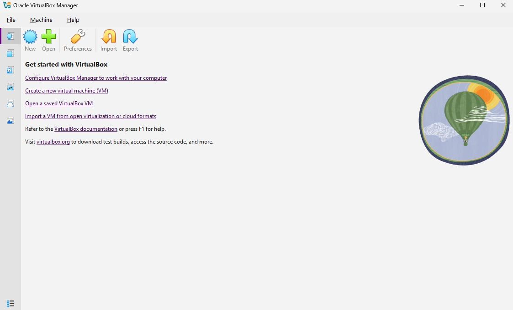
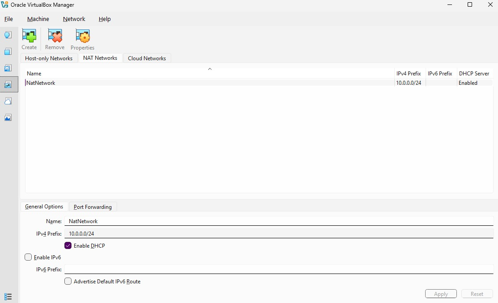
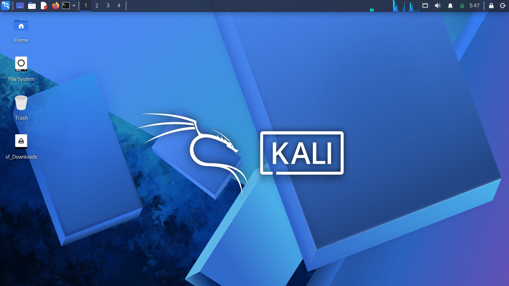
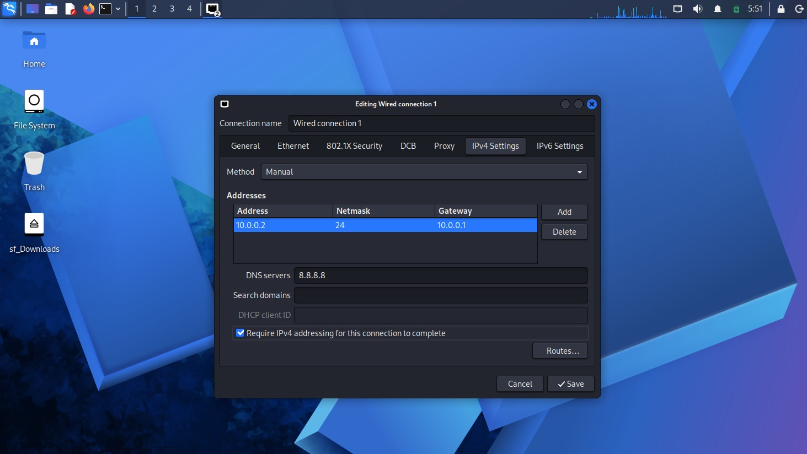
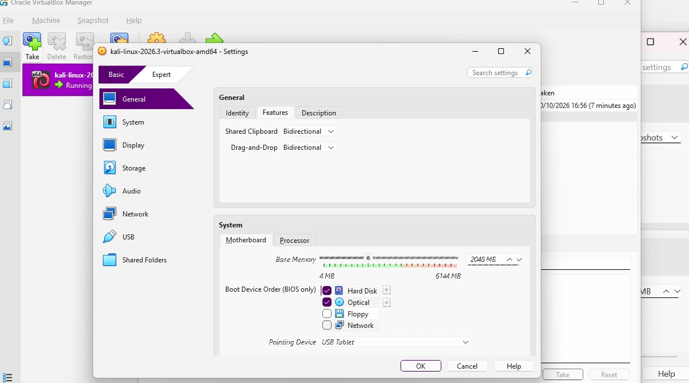
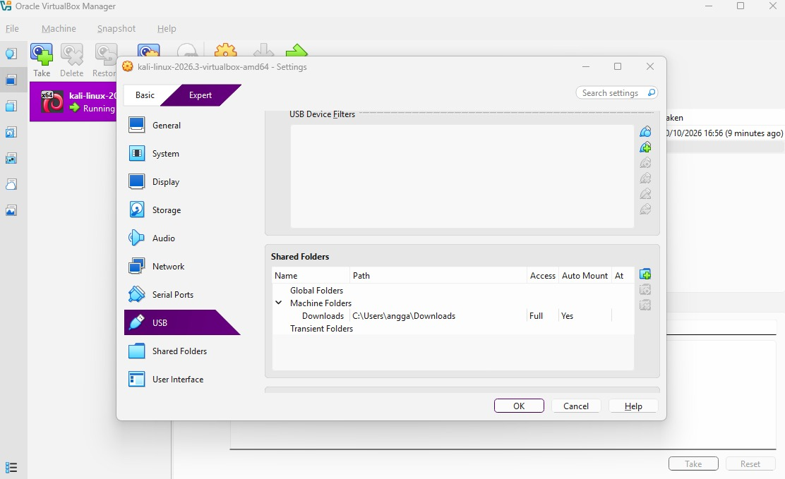
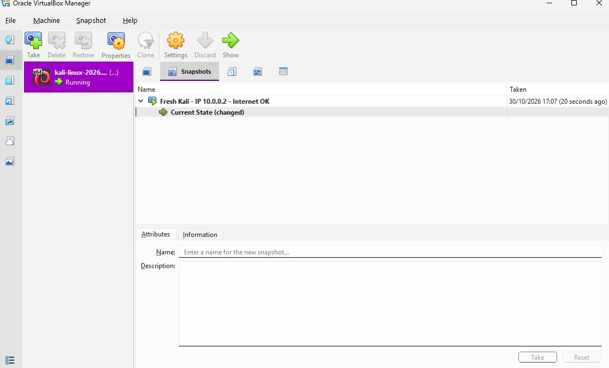
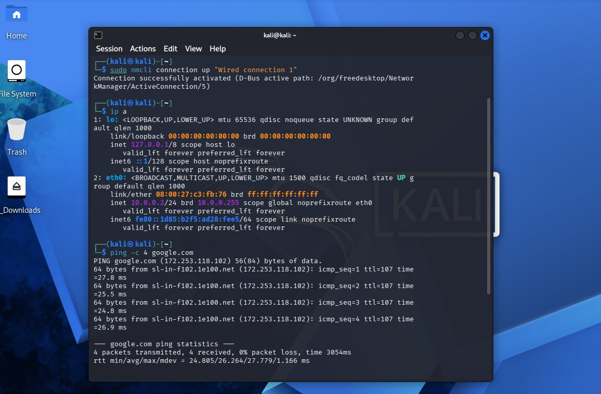

# Week 1: Lab Setup VirtualBox and Kali Linux

**Author:** Angga Yoga Syahputra  
**Program:** Networkwalks Cybersecurity Internship, Batch B084  
**Task:** Week 1, WK1-PM1  
**Date completed:** 30 October 2026  

> A private, isolated cybersecurity practice laboratory deployed on my personal laptop. Kali Linux serves as the attacker workstation, operating inside a dedicated virtual NAT network completely separated from external systems.

---

## 1. What I Built

I constructed a local virtual security lab where I can safely test penetration-testing and network analysis tools throughout the internship. At this stage, the environment hosts Kali Linux as the primary attacker machine, while the `10.0.0.0/24` network is already prepared so additional target machines (such as Windows or Android VMs) can join seamlessly.

```
Windows laptop (host)
    └── VirtualBox
        └── NAT Network "NatNetwork"  10.0.0.0/24
            ├── Kali Linux   10.0.0.2   (attacker)   <- built in this project
            └── future VMs   10.0.0.3 - 10.0.0.99    <- planned
```

---

## 2. Requirements Checklist

| # | Requirement from the task | How I met it |
|---|---|---|
| 1 | Use VirtualBox (latest recommended) | Installed from virtualbox.org |
| 2 | Kali Linux as attacker machine | Imported the pre-built Kali 2026.3 VM |
| 3 | Network in subnet 10.0.0.0/24 | Created a NAT Network with prefix `10.0.0.0/24` |
| 4 | Use NAT Network | Adapter 1 attached to `NatNetwork` |
| 5 | Clipboard and drag/drop enabled | Both set to `Bidirectional` |
| 6 | Shared folder from host Downloads | Added `Downloads` as an auto-mounted shared folder |
| 7 | Kali IP is 10.0.0.2/24 | Configured manual IPv4 address via `nmcli` |
| 8 | Full Internet access | Verified with `ping -c 4 google.com` |
| 9 | Snapshot of the VM | Took a clean baseline snapshot after testing |

---

## 3. My Environment

| Item | Value |
|---|---|
| Host OS | Windows 11 |
| Host RAM / CPU | 8 GB RAM / AMD Ryzen 5 3500U |
| VirtualBox | 7.2.x |
| Kali Linux | 2026.3 (pre-built VirtualBox image) |
| VM resources | 2 CPUs, 2048 MB RAM, ~80 GB virtual disk |
| Network adapter | Intel PRO/1000 MT Desktop on NAT Network |

---

## 4. How I Did It

### 4.1 Tools
I installed **7-Zip** (to extract the compressed `.7z` Kali Linux VirtualBox archive) and **Oracle VirtualBox**.



### 4.2 Creating the network first
In VirtualBox I opened **File > Tools > Network Manager > NAT Networks** and configured the virtual network:

| Setting | Value |
|---|---|
| Name | NatNetwork |
| IPv4 prefix | 10.0.0.0/24 |
| DHCP | Enabled |
| IPv6 | Disabled |

I selected a **NAT Network** rather than standard NAT so that multiple virtual machines inside the lab can communicate directly with each other while still maintaining outbound Internet access.



### 4.3 Importing Kali
I unpacked the Kali Linux `.7z` archive into a dedicated folder and added the `.vbox` file into VirtualBox (**Machine > Add**).



### 4.4 Host and VM integration
With the Kali VM powered off, I opened **Settings** (Expert mode) and configured the following options:

- **Network > Adapter 1:** Attached to = `NAT Network`, Name = `NatNetwork`, Promiscuous Mode = `Allow All`



- **General > Features & System:** Shared Clipboard = `Bidirectional`, Drag-and-Drop = `Bidirectional`, Base Memory = `2048 MB`



- **Shared Folders:** Added my host Downloads folder (`C:\Users\angga\Downloads`) with Auto-mount enabled (`Yes`) and Full access



### 4.5 Static IP in Kali
Inside the Kali Linux terminal, I configured **Wired connection 1** to use manual IPv4 addressing:

```bash
sudo nmcli connection modify "Wired connection 1" \
  ipv4.method manual \
  ipv4.addresses 10.0.0.2/24 \
  ipv4.gateway 10.0.0.1 \
  ipv4.dns 8.8.8.8 \
  ipv4.dad-timeout 0
sudo nmcli connection up "Wired connection 1"
```

Setting `ipv4.dad-timeout 0` disables Duplicate Address Detection wait time, which resolves a common issue where static IP configurations lose Internet access on VirtualBox 7 with newer Kali releases.

### 4.6 Snapshot
Once all configurations and connectivity checks succeeded, I took a clean baseline snapshot named `Fresh Kali - IP 10.0.0.2 - Internet OK` so I can restore the machine to this verified state at any time.



---

## 5. Testing
To verify both the static IPv4 assignment and outbound Internet/DNS connectivity, I ran:

```bash
ip a
ping -c 4 google.com
```

- `eth0` is UP and assigned `10.0.0.2/24`
- `google.com` resolved properly and all ICMP echo requests received replies (0% packet loss), confirming working gateway routing and DNS



---

## 6. Reflection
The main takeaway from this setup was that sequence matters: creating the `NatNetwork` before attaching the VM and adjusting hardware/integration settings while the machine is powered off prevents configuration conflicts. In addition, configuring the network interface via `nmcli` proved much faster and cleaner to document than using GUI menus, and saving a snapshot after full verification guarantees a reliable recovery point for upcoming modules.

**Next steps:** deploy additional target VMs on `NatNetwork` and test inter-VM communication.

---

## 7. Ethics
This lab environment is strictly for educational purposes. I only test virtual machines that I own and control inside this isolated network, or systems for which I have explicit written permission.

---

## 8. References
- 7-Zip: [https://7-zip.org/download.html](https://7-zip.org/download.html)
- VirtualBox: [https://virtualbox.org/wiki/Downloads](https://virtualbox.org/wiki/Downloads)
- Kali Linux: [https://kali.org/get-kali](https://kali.org/get-kali)
- Instructor: Waqas Karim CCIE, Networkwalks
